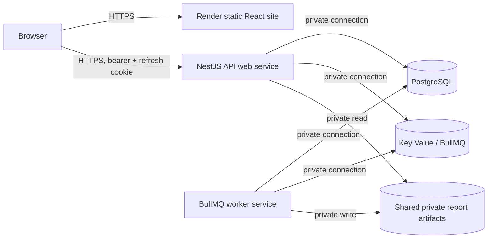

# Staging deployment readiness

Analysis date: 2026-10-16. Scope: repository and deployment design review only. No cloud resource, deployment, migration, database mutation, or application change was made. Platform capabilities below were checked against vendor documentation on this date; plan terms and prices must be reconfirmed before purchase.

Implementation update (2026-10-16): the report-storage blocker described in the original analysis now has a local/S3-compatible storage adapter and validated production-mode selection in source. Production requires `REPORT_STORAGE_PROVIDER=s3` and `REPORT_S3_BUCKET`, `REPORT_S3_REGION`, `REPORT_S3_ACCESS_KEY_ID`, `REPORT_S3_SECRET_ACCESS_KEY`, and `REPORT_S3_OBJECT_PREFIX`; an optional custom endpoint must use HTTPS. The API and worker can construct independent private object-storage clients while retaining the authenticated CSV download contract. The staging runtime review also added validated `REDIS_URL` support for managed `redis://` and TLS `rediss://` endpoints, with production mode requiring that URL. This is code readiness only: no bucket, credentials, lifecycle policy or actual provider integration has been verified. See [report storage staging verification](report-storage-staging-verification.md) and [runtime verification](staging-runtime-verification.md). The original analysis below is retained as a baseline; the overall staging verdict remains unchanged until the remaining infrastructure/configuration checks pass.

Infrastructure-preparation update (2026-10-16): an unprovisioned Render Blueprint and staging release, backup/restore, and rollback runbooks now document the intended first staging topology. The Blueprint disables automatic deployment and contains no cloud credentials, domains, migration command, or object-store resource. It remains a review artifact only; see [staging infrastructure runbook](staging-infrastructure-runbook.md), [release checklist](staging-release-checklist.md), [backup/restore runbook](staging-backup-restore-runbook.md), and [rollback runbook](staging-rollback-runbook.md). Provisioning, secret entry, a controlled migration rehearsal, and all live verification remain pending.

## 1. Executive summary

The application has a substantial CI gate, independent compiled API and worker entry points, live dependency readiness, tenant-scoped persistence, and deterministic PostgreSQL financial truth. The source now supports private shared S3-compatible report storage, but staging still needs a provisioned bucket, scoped credentials, lifecycle policy and provider integration verification. Other required work is listed in sections 5 and 6. Keep financial rules, API contracts, authentication, RBAC, migrations, and the passing CI design unchanged during this analysis.

## 2. Current repository state

At review start: branch `main`, HEAD `7d38968485bf93b95c7314068be4b461b98eba41`, clean worktree. No unrelated changes or untracked files were present. Root owns `docs/`, `docker-compose.yml`, `.github/workflows/verification.yml`, `README.md`, and `AGENTS.md`; there is no root npm package. `backend/` and `frontend/` each own `package.json`, `package-lock.json`, `.env.example`, dependencies, and build output. The root Compose file provisions local PostgreSQL 16 and Redis 7 with named volumes and exposed local ports; it is not a cloud deployment definition. There is no application Dockerfile or hosting manifest.

The backend is JavaScript NestJS under `backend/src/`; Prisma schema, empty seed, checklist, and three SQL migrations are under `backend/prisma/`. Frontend is TypeScript React/Vite under `frontend/src/`. Existing deployment-related context: [backend readiness](production-readiness.md), [frontend readiness](frontend-production-readiness.md), [GitHub verification](github-actions-verification.md), [database design](database-design.md), [domain rules](domain-rules.md), and [repository blueprint](repository-blueprint.md). Historical readiness claims in those documents do not prove this cloud topology.

| Area                      | Existing commands and artifacts                                                                                                                                                                                                                                                               |
| ------------------------- | --------------------------------------------------------------------------------------------------------------------------------------------------------------------------------------------------------------------------------------------------------------------------------------------- |
| Backend install/build/run | From `backend/`: `npm ci`, `npm run db:generate`, `npm run build` (Babel JS to `dist/`), `npm run start:prod` (prebuilt `dist/main.js`), `npm run start:worker:prod` (prebuilt `dist/worker.js`). Development `start` and `start:worker` build first. Node >=22.9, npm >=10; CI uses Node 24. |
| Frontend install/build    | From `frontend/`: `npm ci`, `npm run build` (typecheck then Vite); output `frontend/dist/`. `dev` and `preview` bind localhost and are development/check commands, not staging start commands. Supported Node ranges are in `frontend/package.json`.                                          |
| Backend gates             | `npm run lint`, `npm run format:check`, `npm run test`, `npm run test:integration`, `npm run test:e2e`, `npm run test:queues`, `npm run verify:api-inventory`, `npm run build`. DB/queue suites are guarded for local `sme_cashflow_test`; never point them at staging.                       |
| Frontend gates            | `npm run typecheck`, `npm run lint`, `npm run format:check`, `npm run test`, `npm run test:e2e`, `npm run test:e2e:live`, `npm run build`.                                                                                                                                                    |
| Migration                 | `npm run db:migrate:deploy` maps to `prisma migrate deploy`; `db:migrate:dev` is local development only. Three migrations: `20260927125906_initial_schema`, `20261005000000_invoice_document_evidence`, `20261009000000_reminder_notification_tenant_fk`.                                     |

## 3. Current runtime architecture

| Component               | Entry/start/build                                                                                   | Environment, dependencies, networking, storage, replicas and shutdown                                                                                                                                                                                                                                                                                                                                                                                       |
| ----------------------- | --------------------------------------------------------------------------------------------------- | ----------------------------------------------------------------------------------------------------------------------------------------------------------------------------------------------------------------------------------------------------------------------------------------------------------------------------------------------------------------------------------------------------------------------------------------------------------- |
| Browser/static frontend | `frontend/src/main.tsx`; build `npm run build`, serve `dist/` on a static host                      | `VITE_API_BASE_URL` is baked into the build. Browser makes outbound HTTPS calls to API; inbound HTTPS site. No server-side DB/Redis or writable storage. CDN replicas are safe if built with the same API URL.                                                                                                                                                                                                                                              |
| NestJS HTTP API         | `backend/src/main.js`; `npm run start:prod` after Babel build and Prisma generate                   | `DATABASE_URL`, signing pair, app/auth settings, required production `REDIS_URL`, queue namespace and S3 report settings. Inbound HTTP behind HTTPS proxy on `PORT`; outbound PostgreSQL/Redis. Report downloads require private persisted artifact storage shared with worker. API replicas require this shared store and DB pool budgeting. `configureApplication` enables Nest shutdown hooks; Prisma and Queue/Redis providers close on module destroy. |
| BullMQ process          | `backend/src/worker.js` + `worker.module.js`; `npm run start:worker:prod` after same build/generate | Same DB, Redis URL, signing/config validation, notification/report settings; no inbound HTTP. Outbound DB/Redis, optional future email provider and shared S3 storage. Multiple workers can process jobs with BullMQ plus PostgreSQL claims/deduplication, but scheduler and connection behavior must be staging-tested; start with one. Nest shutdown hooks and worker `close()` exist. No worker health HTTP endpoint.                                    |
| PostgreSQL              | `backend/prisma/schema.prisma` / managed service                                                    | Authoritative tenant, authentication, invoice, payment, expense, audit, pending-event, export metadata, and idempotency state. Private inbound DB connection from API, worker, one migration runner. Persistent backups required.                                                                                                                                                                                                                           |
| Redis/Key Value         | `backend/src/infrastructure/redis/redis.connection.js` and BullMQ                                   | Queue transport and auth throttling, not financial truth. Private inbound from API/worker. Local Compose enables AOF; managed persistence/eviction policy must be chosen explicitly. Loss can delay/retry side effects; PostgreSQL pending events are durable handoff.                                                                                                                                                                                      |

No separate cron process exists. `NotificationWorkers` registers a five-second pending-event dispatch scheduler and a one-minute reminder scan; `ReportWorkers` registers a five-second report dispatch scheduler. Only the worker composition starts these schedulers. `QUEUE_NAMES` also declares `infrastructure-smoke` and `sessions.cleanup`, but no deployed business consumer/scheduler for those names was found; do not invent a cleanup daemon.

## 4. Deployment readiness verdict

CI and core runtime are technically strong. The source-level shared report-storage blocker is addressed, but production configuration requires S3 mode and no real provider or bucket has been verified. Resolve the remaining BLOCKER items and required staging configuration below before issuing any deploy approval. No application or provider was deployed as part of this review.

## 5. Blocking findings

| Severity                                         | Evidence and affected files                                                                                                                                                                                                                         | Risk                                                                                                   | Required remediation and change type                                                                                                                                                                                                                                                                                                                                                                                                                                                                                 |
| ------------------------------------------------ | --------------------------------------------------------------------------------------------------------------------------------------------------------------------------------------------------------------------------------------------------- | ------------------------------------------------------------------------------------------------------ | -------------------------------------------------------------------------------------------------------------------------------------------------------------------------------------------------------------------------------------------------------------------------------------------------------------------------------------------------------------------------------------------------------------------------------------------------------------------------------------------------------------------- |
| **BLOCKER**                                      | `backend/src/modules/reports/infrastructure/report-storage.js` resolves a process-local directory; worker writes via `report-generation.service.js`, API reads via `reports.service.js`. `REPORT_STORAGE_DIRECTORY` defaults to `.private/reports`. | Separate service filesystems and redeploys make READY exports unavailable; report content may be lost. | Before staging, provide a private, durable artifact store accessible to both processes, with access control, retention/cleanup, and verified download. For the recommended Render topology, implement private object storage behind the existing storage boundary: Render persistent disks cannot be accessed by another service or replica. [Render disk limits](https://render.com/docs/disks). **Source code plus deployment infrastructure/configuration**, with no change to report API or financial semantics. |
| **BLOCKER if existing invoice data is imported** | `backend/prisma/migrations/20261005000000_invoice_document_evidence/migration.sql` adds a CHECK requiring issuer and bill-to evidence on non-DRAFT invoices; its comment explicitly forbids invented backfill.                                      | Migration fails on a legacy populated database and blocks rollout.                                     | Use a fresh isolated staging database with synthetic data for first staging, or review and remediate historical evidence before this migration. Do not fabricate data or edit the reviewed SQL. **Data migration planning/infrastructure**, conditional for fresh staging.                                                                                                                                                                                                                                           |

The report-storage row records the original source defect. Its source remediation is implemented and has unit coverage; staging remains blocked until the private S3-compatible bucket, credentials, lifecycle policy and actual API/worker round trip are configured and verified. The conditional invoice migration finding remains unresolved for any imported legacy data.

## 6. High-priority findings

| Severity | Evidence and affected files                                                                                                                                                                            | Risk                                                                                                                | Required remediation and change type                                                                                                                                                                                                                                                                                                                                                                                                                                                                                                  |
| -------- | ------------------------------------------------------------------------------------------------------------------------------------------------------------------------------------------------------ | ------------------------------------------------------------------------------------------------------------------- | ------------------------------------------------------------------------------------------------------------------------------------------------------------------------------------------------------------------------------------------------------------------------------------------------------------------------------------------------------------------------------------------------------------------------------------------------------------------------------------------------------------------------------------- |
| HIGH     | `backend/src/config/env.schema.js` defaults `NODE_ENV=development`; `auth.config.js` derives cookie Secure from production mode.                                                                       | Missing setting yields insecure-cookie behavior and weaker origin requirements.                                     | Explicit `NODE_ENV=production` for API and worker, unique matching signing pair, exact HTTPS CORS origin; fail deployment on absent values. **Runtime configuration**.                                                                                                                                                                                                                                                                                                                                                                |
| HIGH     | `backend/src/infrastructure/redis/redis.connection.js` builds host/port/user/password/db options but no TLS option or URL parser. `env.schema.js` has no Redis TLS switch.                             | A TLS-only managed Redis endpoint cannot be used safely with current configuration.                                 | Choose a verified private endpoint compatible with current client and restricted network access for first staging; if TLS is required, add validated TLS support in the next milestone and test both API and BullMQ connections. **Infrastructure, possibly source code**. Render internal Key Value supports private unauthenticated or authenticated `redis://` access; external access uses TLS. [Render Key Value](https://render.com/docs/key-value), [ioredis guide](https://render.com/docs/connecting-to-redis-with-ioredis). |
| HIGH     | `backend/src/main.js` listens on configured port; `backend/src/bootstrap.js` sets `TRUST_PROXY`, currently false by default.                                                                           | Incorrect proxy trust can corrupt client IP attribution and auth throttling; health routing can fail on wrong port. | Set platform `PORT` and a narrowly validated trusted-proxy setting; test request IP and HTTPS headers behind the chosen proxy. **Runtime configuration**. Do not blindly trust arbitrary forwarded headers.                                                                                                                                                                                                                                                                                                                           |
| HIGH     | `frontend/src/lib/env.ts` requires one `VITE_API_BASE_URL`; `frontend/.env.example` points to localhost. `backend/.env.example` also has localhost DB/Redis/CORS and published local signing fixtures. | Build may call localhost or use development settings remotely.                                                      | Build a staging-specific immutable frontend artifact with `https://api-staging.<domain>/api/v1`, configure matching backend origins and distinct secrets; production startup rejects the published public key but staging uses `NODE_ENV=production` to activate that guard. **Build/runtime configuration**.                                                                                                                                                                                                                         |
| HIGH     | `.github/workflows/verification.yml` verifies code but has no staging deployment, environment approval, release artifact, or remote smoke gate.                                                        | A passing PR does not establish a safe release or reviewed migration.                                               | Define a manual/approved staging release procedure and later automate only after its first rehearsed run. Preserve verification workflow. **Deployment process/infrastructure**.                                                                                                                                                                                                                                                                                                                                                      |
| MEDIUM   | `backend/src/modules/reports/infrastructure/report-storage.js` has write/read/discard but no timed artifact cleanup scheduler; `REPORT_EXPIRY_HOURS` governs access metadata.                          | Expired CSV files accumulate in durable storage.                                                                    | Set retention and safe garbage collection with audit/authorization preservation. **Source code or storage lifecycle policy**.                                                                                                                                                                                                                                                                                                                                                                                                         |
| MEDIUM   | `backend/src/worker.js` exposes no HTTP readiness endpoint; workers log generic failures.                                                                                                              | Hosting health cannot prove consumers and scheduled scans are operating.                                            | Monitor worker process, Redis connection, queue failed counts/oldest pending event, and a synthetic report/reminder probe. **Operational configuration; optional narrow code probe**.                                                                                                                                                                                                                                                                                                                                                 |
| MEDIUM   | `backend/prisma/schema.prisma` uses a bare `DATABASE_URL`; no pool budget, SSL policy, or managed restore specification is configured in repository.                                                   | Connection exhaustion or unintended cleartext connection outside private network.                                   | Validate provider TLS/private connection, max connections and Prisma per-process pool sizing with both services; test backup/restore. **Infrastructure/runtime configuration**.                                                                                                                                                                                                                                                                                                                                                       |
| LOW      | `backend/prisma/seed.js` intentionally inserts no data.                                                                                                                                                | `db:seed` will not prepare a useful staging workflow.                                                               | Create synthetic test records through approved application flows only. **Verification process**.                                                                                                                                                                                                                                                                                                                                                                                                                                      |

## 7. Environment variable matrix

`Y` = explicitly required, `D` = validated default exists, `O` = optional, `—` = not used. For staging/production, `R` means **set explicitly** even where code has a development default. `S` denotes secret. Backend variables are parsed in `backend/src/config/env.schema.js` through Nest ConfigModule; `DATABASE_URL_TEST` and Compose variables are outside that validator. Formats are placeholders, never live values. Both API and worker import the backend configuration and therefore need the validated required fields, even if one process does not directly use a feature.

| Variable                                                                                                                                        | Consumer                   | Local | Test        | Staging     | Production  | Secret                      | Validation / safe format                                                                                                                                              |
| ----------------------------------------------------------------------------------------------------------------------------------------------- | -------------------------- | ----- | ----------- | ----------- | ----------- | --------------------------- | --------------------------------------------------------------------------------------------------------------------------------------------------------------------- |
| `NODE_ENV`                                                                                                                                      | API, worker                | D     | R           | R           | R           | No                          | enum; `production` on deployed processes                                                                                                                              |
| `PORT`                                                                                                                                          | API                        | D     | D           | R           | R           | No                          | 1–65535; platform assigned integer                                                                                                                                    |
| `API_PREFIX`                                                                                                                                    | API, auth cookie path      | D     | D           | R           | R           | No                          | single lower-case segment; `api`                                                                                                                                      |
| `API_VERSION`                                                                                                                                   | API, auth cookie path      | D     | D           | R           | R           | No                          | numeric string; `1`                                                                                                                                                   |
| `CORS_ORIGINS`                                                                                                                                  | API/auth                   | D     | D           | R           | R           | No                          | comma-separated exact origins, no `*`; `https://staging.example.com`                                                                                                  |
| `LOG_LEVEL`                                                                                                                                     | API/worker logging         | D     | D           | R           | R           | No                          | enum; `info`                                                                                                                                                          |
| `TRUST_PROXY`                                                                                                                                   | API                        | D     | D           | R           | R           | No                          | `true`/`false`; choose for actual trusted proxy                                                                                                                       |
| `DATABASE_URL`                                                                                                                                  | Prisma API/worker/migrator | R     | R           | R           | R           | **S**                       | PostgreSQL URL shape validated; `postgresql://user:<secret>@db.internal:5432/staging_db?sslmode=require` (TLS policy/provider compatibility still needs verification) |
| `DATABASE_URL_TEST`                                                                                                                             | guarded scripts/CI only    | R     | R           | —           | —           | **S**                       | script guard, not Nest schema; local `sme_cashflow_test` only                                                                                                         |
| `POSTGRES_DB`, `POSTGRES_USER`, `POSTGRES_PASSWORD`, `POSTGRES_PORT`                                                                            | root local Compose         | R     | O           | —           | —           | password **S**              | Compose interpolation only; `sme_cashflow`, `sme_app`, `<secret>`, `5432`                                                                                             |
| `REDIS_HOST`, `REDIS_PORT`, `REDIS_DB`                                                                                                          | API/worker                 | D     | D           | R           | R           | No                          | nonempty host, port 1–65535, DB >=0; `redis.internal`, `6379`, `0`                                                                                                    |
| `REDIS_USERNAME`, `REDIS_PASSWORD`                                                                                                              | API/worker                 | O     | O           | conditional | conditional | password **S**              | optional nonempty; `default`, `<secret>`                                                                                                                              |
| `REDIS_URL`                                                                                                                                     | API/worker                 | O     | O           | R           | R           | **S** when credentialed     | required in production mode; `redis://` private or TLS `rediss://` provider URL                                                                                       |
| `QUEUE_PREFIX`                                                                                                                                  | API/worker                 | D     | D           | R           | R           | No                          | safe namespace; `sme:staging` (separate from production)                                                                                                              |
| `REMINDERS_ENABLED`                                                                                                                             | worker                     | D     | D           | R           | R           | No                          | boolean string; `true` or `false` per approved email plan                                                                                                             |
| `REMINDERS_DAYS_BEFORE_DUE`, `REMINDERS_OVERDUE_CADENCE_DAYS`                                                                                   | worker                     | D     | D           | R           | R           | No                          | bounded integers; `3`, `7`                                                                                                                                            |
| `EMAIL_PROVIDER`                                                                                                                                | worker                     | D     | D           | R           | R           | No                          | `disabled` or `capture`; production mode rejects `capture`. No external email integration exists.                                                                     |
| `WORKER_CONCURRENCY`                                                                                                                            | worker                     | D     | D           | R           | R           | No                          | 1–20; start `2` and review DB limits                                                                                                                                  |
| `REPORT_STORAGE_DIRECTORY`                                                                                                                      | API/worker                 | D     | D           | R           | R           | No                          | nonempty path; `/private/reports` only with proven shared persistent mount                                                                                            |
| `REPORT_EXPIRY_HOURS`                                                                                                                           | API/worker report service  | D     | D           | R           | R           | No                          | 1–168; `24`                                                                                                                                                           |
| `AUTH_ACCESS_PRIVATE_KEY_BASE64`                                                                                                                | API/worker startup         | R     | R           | R           | R           | **S**                       | length plus Ed25519 pair check; `<base64-private-key>`                                                                                                                |
| `AUTH_ACCESS_PUBLIC_KEY_BASE64`                                                                                                                 | API/worker startup         | R     | R           | R           | R           | public, integrity-sensitive | matching `<base64-public-key>`; published demo pair rejected in production mode                                                                                       |
| `AUTH_ACCESS_TOKEN_LIFETIME_SECONDS`, `AUTH_REFRESH_TOKEN_LIFETIME_DAYS`                                                                        | API                        | D     | D           | R           | R           | No                          | bounded integers; `900`, `30`                                                                                                                                         |
| `AUTH_JWT_ISSUER`, `AUTH_JWT_AUDIENCE`, `AUTH_JWT_KEY_ID`                                                                                       | API                        | D     | D           | R           | R           | No                          | nonempty; distinct deployment identifiers such as `sme-staging-api`, `sme-staging-client`, `staging-2026-01`                                                          |
| `AUTH_COOKIE_NAME`                                                                                                                              | API                        | D     | D           | R           | R           | No                          | alphanumeric/underscore/hyphen; `sme_refresh`                                                                                                                         |
| `AUTH_RATE_LIMIT_PREFIX`                                                                                                                        | API/Redis                  | D     | D           | R           | R           | No                          | safe namespace; `sme:staging:auth-rate`                                                                                                                               |
| `AUTH_REGISTER_RATE_LIMIT_PER_HOUR`, `AUTH_LOGIN_RATE_LIMIT_PER_MINUTE`, `AUTH_LOGIN_RATE_LIMIT_PER_HOUR`, `AUTH_REFRESH_RATE_LIMIT_PER_MINUTE` | API/Redis                  | D     | D           | R           | R           | No                          | positive integers; `5`, `5`, `20`, `30`                                                                                                                               |
| `VITE_API_BASE_URL`                                                                                                                             | frontend build/browser     | R     | R           | R           | R           | No, public                  | Zod URL ending `/api/v1`; `https://api-staging.example.com/api/v1`                                                                                                    |
| `CI`                                                                                                                                            | CI helper only             | —     | conditional | —           | —           | No                          | `true` guard in `backend/scripts/prepare-ci-env.js`; not app config                                                                                                   |
| `TEST_STABILITY_DIAGNOSTICS`                                                                                                                    | frontend test helper only  | O     | O           | —           | —           | No                          | optional local diagnostics path; not app config                                                                                                                       |

`REDIS_URL` is supported for managed `redis://` and TLS `rediss://` endpoints and is required in production mode. There remains no separate `REDIS_TLS` or cookie-domain variable; TLS follows `rediss://`. `VITE_API_BASE_URL` is public and fixed when Vite builds; changing API host requires a frontend rebuild. The backend validator checks string shape, not actual PostgreSQL SSL, endpoint reachability, queue behavior, or storage sharing. DB pool/SSL, artifact retention, and provider-specific settings therefore require deployment proof.

## 8. Authentication, HTTPS, cookie and CORS analysis

`auth.controller.js`, `auth.service.js`, `access-token.service.js`, and `access-auth.guard.js` implement a short-lived Ed25519 bearer access token tied to current active User and RefreshSession state. PostgreSQL stores a RefreshSession and hashed, single-use refresh-token rows. Refresh rotates the credential; reuse compromises the session family. Logout revokes the current session, logout-all revokes active sessions, and controller clears the browser cookie. JWTs do not carry tenant roles/permissions. Current Membership checks still authorize each organization request.

The refresh cookie is `HttpOnly`, `SameSite=Lax`, `Secure` only when `NODE_ENV=production`, host-only (no `Domain` attribute), and scoped to `/${API_PREFIX}/v${API_VERSION}/auth`; the same settings are used when clearing it. Frontend `createApiClient` always uses `credentials: 'include'`, sends bearer access tokens, and keeps refresh tokens inaccessible to JavaScript. API CORS allows configured exact origins with credentials, selected methods/headers, and exposed request/ETag headers. Production mode requires explicit HTTPS origins. Login checks supplied Origin/Referer; production cookie refresh/logout requires allowed Origin or Referer. Authentication POSTs require JSON, including `{}` for empty commands. These are existing checks, not a blanket CSRF token scheme; retain same-site domains and verify actual browser behavior.

`https://staging.<domain>` and `https://api-staging.<domain>` are cross-origin but same-site when both share the same registrable domain and HTTPS. Host-only cookie belongs to the API host and should be sent on credentialed API refresh/logout calls with Lax semantics. Exact frontend origin must appear in `CORS_ORIGINS`; the API URL must be the staging HTTPS host. A frontend on an unrelated provider domain is cross-site: Lax refresh cookies may be withheld even when CORS succeeds. Do not switch to `SameSite=None` casually; use the shared custom-domain topology and browser smoke tests. Set Secure via production mode, terminate HTTPS at the platform, and configure `TRUST_PROXY` to the actual trusted proxy boundary; validate `request.ip`, scheme forwarding, rate limits, and cookie receipt. No cookie-domain override exists or is needed for the proposed sibling subdomains. Distinct production hosts use analogous settings and isolated keys/cookies.

## 9. Frontend deployment analysis

Vite emits `frontend/dist/` and is safe for a static host: no frontend server state or DB connection exists. Supply `VITE_API_BASE_URL` before `npm run build`; `frontend/src/lib/env.ts` rejects missing/malformed URLs and requires `/api/v1`. Client-side React Router has nested `/organizations/:organizationId/...` routes. Configure a host rewrite of non-asset routes to `/index.html` and verify direct refresh/navigation while missing assets still return real 404s. Render documents a catch-all SPA rewrite. [Render static rewrites](https://render.com/docs/redirects-rewrites). Keep hashed assets cacheable, serve `index.html` with short/no cache to avoid stale API bootstrap, decide whether source maps are published, and verify lazy chunks and CSV downloads. `AuthProvider` restores a session then loads `/me`; `ProtectedRoute` and organization selection handle bootstrap/routing. Error components and API client map network/invalid response errors. No production API proxy is present. `vite preview` is a check command, not the static deployment service.

## 10. NestJS API deployment analysis

Use one prebuilt Node web process initially, public inbound HTTPS only through the platform. The API itself listens on `PORT`, sets Helmet and CORS, exposes `/api/v1/health/live` and `/api/v1/health/ready`, and uses structured pino request logs with request IDs, allowlisted serializers, and redaction. `live` is process liveness; `ready` queries PostgreSQL `SELECT 1` and Redis `PING`, returning 503 safely on failure. Neither verifies shared report storage or the worker. Health probes should call these exact paths. Do not put migration execution in every API start or move queue consumers into the API. Release must include generated Prisma client and Babel `dist/`, Node compatible with both packages, and platform-injected environment. The current `start:prod` permits an optional local `.env`; cloud should inject values through its secret store and avoid shipping `.env`.

## 11. BullMQ worker deployment analysis

`backend/src/worker.module.js` imports notification and report workers, not the HTTP AppModule. `start:worker:prod` is a real existing command. No inbound port is required. Worker startup checks DB and queue readiness for notifications, then registers processors and schedules. `NotificationWorkers` runs `events.dispatch` and `reminders.scan` at concurrency 1 and `reminders.deliver`/`notifications.email` at configured concurrency. `ReportWorkers` runs `reports.generate` at configured concurrency. `EMAIL_PROVIDER=disabled` means in-app notifications can be exercised but outbound email is not delivered; `capture` is development/test only and rejected in production mode. Stop/drain must allow BullMQ `worker.close()` and Prisma/Redis closure within provider termination grace; verify with an in-flight synthetic export. A worker crash should surface in platform process monitoring, failed-job counts, and pending-event age. No HTTP worker readiness exists.

## 12. PostgreSQL / Prisma migration analysis

`schema.prisma` defines PostgreSQL with Decimal financial amounts and tenant-composite relations. The initial SQL adds financial and lifecycle CHECK constraints, partial unique indexes (including one active Owner, one active refresh token, invoice number, invitation and deduplication keys), tenant composite FKs, restrictive historical actor FKs, and an append-only audit trigger. The second migration adds issuer/bill-to evidence and a stricter invoice CHECK; it is **not safely backward-compatible with populated legacy issued invoices without reviewed evidence**. The third replaces the reminder/notification FK with a tenant-composite FK and column-specific `SET NULL(notificationId)`, preserving `organizationId`. These custom SQL constructs must remain in migration review; Prisma schema alone does not encode all of them. Invoice number uniqueness plus transaction/locking rules and payment idempotency are implemented in code and DB; validate their concurrent behavior with synthetic checks, not manual SQL edits.

Safe staging procedure: (1) pin the reviewed commit and inspect all three SQL files and target DB identity; (2) provision a fresh isolated PostgreSQL 16 database with restricted migration credentials, connection and backup plan; (3) take a pre-change backup if data exists and verify restore access; (4) run `npm run db:generate` during build and **once** run `npm run db:migrate:deploy` from `backend/` with the staging `DATABASE_URL`, in a controlled migration job before API/worker rollout; (5) inspect migration status and critical constraints/indexes/trigger on the target without mutating business rows; (6) release API then worker, with shared artifact storage ready; (7) smoke test. Do not use `migrate dev`, `db push`, `migrate reset`, `db:seed` as a substitute for synthetic workflows, or guarded clearing test suites on staging.

Application rollback is not database rollback. The initial schema is additive for a fresh DB. The invoice-evidence migration adds stricter fields/checks, so an older app version that writes non-DRAFT invoices without evidence cannot safely run against the migrated DB. The notification FK replacement can reject existing cross-tenant links; inspect before migration if importing data. Plan forward corrective migrations or PITR for serious failure, not routine destructive reset.

## 13. Redis / queue analysis

Canonical queue names: `events.dispatch`, `reminders.scan`, `reminders.deliver`, `notifications.email`, `reports.generate`; catalog-only `infrastructure-smoke` and `sessions.cleanup` are not currently deployed workers. API-side producers write PostgreSQL `pending_events` transactionally; worker dispatch publishes versioned organization/event IDs after commit. Consumers validate payloads, reload tenant-scoped state, and use PostgreSQL claim/status/idempotency state. Queue defaults are 3 attempts, exponential 1-second backoff, keep up to 1,000 completed and 5,000 failed jobs; event dispatch adds jitter. Dispatch has a two-second publish timeout, a recoverable claim lease, and retry deferral. Failed jobs log generic errors and durable statuses need review. Monitor failed counts and oldest pending events. Redis is transport/throttling infrastructure, **never financial truth**. Use a private endpoint, isolated prefix/database, acceptable persistence/eviction configuration, and provider auth. Local AOF in Compose does not prove managed persistence. The client now supports `redis://` and `rediss://` through `REDIS_URL`, including TLS and URL credentials without logging the URL; live provider behavior remains required before staging. Keep one worker replica initially; extra replicas require load, scheduler and DB pool tests.

## 14. Backup and restore plan

**Staging:** choose a paid/qualified PostgreSQL tier with documented automated backups and retention, record recovery window and access restrictions, make a pre-migration backup for risky changes, and rehearse restore into a separate isolated database before relying on it. Set an explicit staging target such as ≤24 hours recoverable data loss and ≤1 business day recovery, then confirm provider capability. Use private DB networking and TLS where supported/required; verify the actual Prisma URL and certificate behavior. Budget connections across web, worker, migration runner and restore/maintenance tasks. Do not expose public DB access to browsers.

**Production:** agree RPO/RTO with the owner, require automated backup plus PITR with retention meeting that target, perform periodic offsite/logical backup and restore rehearsal, restrict backup and restore privileges, and record runbook ownership. For a Render-centered option, paid Render Postgres currently advertises PITR with a plan-dependent recovery window; free instances do not provide that guarantee. [Render backup policy](https://render.com/docs/postgresql-backups). Railway offers separately enabled volume backups, PITR, and logical exports, each with different restore semantics. [Railway backup guide](https://docs.railway.com/guides/postgres-backups-restores). Neither is a verified backup until a restore has been rehearsed for the selected plan.

## 15. Hosting options comparison

Approximate low-traffic cost categories only: **low** means a few paid small services/datastores, **moderate** adds separate provider fees or durable storage. Confirm current plan prices, backup retention, private networking, and limits before provisioning.

| Criterion                       | A. Render-centered                                                                                                                                                   | B. Railway-centered                                                                                                                          | C. Vercel frontend + Render/Railway backend                                                                            |
| ------------------------------- | -------------------------------------------------------------------------------------------------------------------------------------------------------------------- | -------------------------------------------------------------------------------------------------------------------------------------------- | ---------------------------------------------------------------------------------------------------------------------- |
| Fit/complexity                  | Strong fit: static site, web, continuously running background worker, Postgres, Key Value in one workspace; low setup complexity.                                    | Good fit: API/worker services and DB/Redis; React often served through a Caddy/static container; moderate setup.                             | Good frontend CDN fit, but two-provider configuration, domains and billing; moderate complexity.                       |
| Workers/Redis                   | Dedicated background worker and Redis-compatible Key Value; private same-region links.                                                                               | Persistent service worker and Redis template/private service networking; validate chosen service/template settings.                          | Backend still needs A or B worker and Redis; Vercel functions are not a substitute for the long-running BullMQ worker. |
| Postgres/backups                | Managed Postgres; paid tier PITR subject to workspace plan/window.                                                                                                   | Postgres service with volume; backup/PITR options require explicit enabling and verification.                                                | Backend provider owns DB/backup risk.                                                                                  |
| Network/HTTPS/domains           | Internal DB/Key Value links; managed public TLS/custom domains; static site is outside private network.                                                              | Private networking for services; managed public TLS/custom domains; check template and plan.                                                 | Cross-provider public HTTPS between browser and API; use sibling custom domains to preserve same-site cookie behavior. |
| Env/secrets                     | Platform service settings; separate build-time Vite setting and API/worker runtime secrets.                                                                          | Service variables/references; frontend build value separate.                                                                                 | Secrets split across providers; more configuration drift risk.                                                         |
| Logs/rollback/CI                | Service logs and previous-deploy rollback; existing GitHub CI can gate manual release. Rollback does not reverse migrations or disk contents.                        | Service logs and deployment rollback; volumes can affect rollout downtime; existing GitHub CI still gates.                                   | Independent frontend and backend rollback introduces version coordination.                                             |
| Staging/production/cost/lock-in | Recommended for first staging; plausible small production with paid datastore/backup and shared artifact solution. Low-to-moderate cost, moderate provider coupling. | Suitable staging/production if backup/network and worker behavior verified. Low-to-moderate cost, moderate coupling to service/volume model. | Suitable later if frontend delivery needs justify split. Moderate cost/operations; more cross-provider coupling.       |

Render documents [static sites, web services, workers, Postgres and Key Value](https://render.com/docs/service-types), [private networking](https://render.com/docs/private-network), and [deploy/rollback behavior](https://render.com/docs/deploys), [rollbacks](https://render.com/docs/rollbacks). Railway documents [React/Vite deployment](https://docs.railway.com/guides/react), [monorepos](https://docs.railway.com/guides/deploying-a-monorepo), [Postgres backup options](https://docs.railway.com/guides/postgres-backups-restores), and [rollback limitations with volumes](https://docs.railway.com/guides/roll-back-bad-deploy). Vercel documents [Vite build-time variables](https://vercel.com/docs/frameworks/frontend/vite). These are platform capabilities, not a claim that this repository is already configured for them.

## 16. Recommended staging architecture

Choose **Render-centered, one isolated staging environment** after resolving report storage. Serve Vite `dist/` as a Render static site with SPA rewrite; run one NestJS web service and one separate continuously running BullMQ background worker from the same pinned commit. Use paid managed PostgreSQL 16 and a same-region private Render Key Value endpoint with verified auth/network compatibility. Use a private durable object store shared by API and worker through a bounded `ReportStorage` implementation; a Render disk attached to one service cannot serve the other. Start one API and one worker replica. Build with service root directories (`frontend/`, `backend/`), separate lockfiles, and pinned runtime. Keep deployment manual until the procedure is rehearsed and approved.

## 17. Domain and network topology

Staging: `staging.<domain>` for frontend and `api-staging.<domain>` for API. Production later: `app.<domain>` and `api.<domain>`. Both pairs share the registrable domain, use HTTPS, and keep the API cookie host-only. Point the frontend build at the appropriate `/api/v1`; allow only the corresponding exact frontend origin in backend CORS and auth origin checks. Route only the API through its public service. DB, Redis and artifact storage must not be publicly browser-accessible. Configure static route fallback and verify TLS certificates before browser auth checks. No domain purchase/configuration occurred here.

## 18. Secret-management plan

Use platform secret/environment storage with separate staging and production values and least-privilege service access. Generate independent Ed25519 signing pairs; private key only in API/worker secret storage, public key and key ID paired with deployment, and document an overlap/session invalidation rotation plan. Isolate DB user/password, Redis credentials, queue prefixes, and any future third-party credentials. GitHub Actions needs deployment credentials only if a future gated deployment workflow truly uses them; current verification requires none. Keep ignored `.env` local, never ship it in artifacts, and avoid secret values in logs, CI artifacts or docs. A `git ls-files` path audit found tracked example env files but no tracked private key or real-looking credential file. `backend/.env.example` includes a **published development Ed25519 key pair** and local placeholder DB password; these are fixtures, not staging secrets, and production-mode startup rejects the published public key. Do not copy them into deployed settings. No real secret value was reproduced in this report. A full historical secret scan was not run; perform one before public release if required.

## 19. Proposed deployment sequence (not executed)

1. Approve the report-storage solution and resolve blockers; pin reviewed commit, confirm provider plan/backup/network/Node compatibility and clean release artifact.
2. Create an isolated staging project/environment and assign sibling HTTPS domains; provision restricted paid PostgreSQL 16, private Key Value, and private shared artifact storage.
3. Set platform secrets and explicit production-mode staging configuration for API/worker; choose Redis-compatible private endpoint and validate DB TLS/pool budget. Configure frontend build-time `VITE_API_BASE_URL` and static rewrite.
4. Build backend with `npm ci`, `npm run db:generate`, `npm run build`; build frontend with `npm ci`, `npm run build`. Preserve independent app roots and lockfiles.
5. Check DB identity and migration history, inspect SQL and any imported legacy rows, take/verify pre-change backup if populated; execute `npm run db:migrate:deploy` **once** from `backend/` using staging credentials. Verify migration status and key constraints.
6. Deploy prebuilt API only; verify `/api/v1/health/live`, `/api/v1/health/ready`, HTTPS, safe logs and trusted proxy behavior. Do not send live traffic to an unready process.
7. Deploy prebuilt worker separately; confirm startup, scheduler/queue connectivity, one synthetic pending-event dispatch and graceful stop/restart. Verify shared artifact write/read across worker/API.
8. Publish frontend static build with SPA rewrite; verify direct links, assets, HTTPS API URL, CORS and cookie refresh/logout in real browsers.
9. Create only approved synthetic users/organizations through product flows. Run the financial and tenant checks below, inspect queue errors, DB connections and logs, then record commit, migration version, artifact version, smoke evidence and release decision.

## 20. Rollback strategy

Record known-good frontend build, API/worker commit, config snapshot (secret references, not values), and migration state before release. Roll frontend to prior static deploy if browser/assets fail; roll API and worker as a coordinated compatible pair, draining in-flight jobs and confirming idempotent resume. Restore previous configuration values through the platform with an audit trail. Verify `live`/`ready`, queue processing, and browser auth after rollback. A provider rollback reuses a prior deployment but **does not reverse PostgreSQL schema or artifact writes**. Before every migration, check old/new binary compatibility. In particular, rolling the API back before the invoice-evidence migration may make its writes fail. Prefer a forward corrective migration for recoverable schema defects; use isolated restored DB/PITR and a deliberate cutover for serious data corruption. Never use `prisma migrate reset` as a staging rollback. Rehearse a restore separately before depending on PITR.

## 21. Staging financial verification plan — synthetic data only

Use invented organizations A/B, users, customers and financial amounts; no real SME/PII or customer financial data. Keep stable request IDs and new idempotency keys. Run through browser plus selected direct API calls and compare string Decimal amounts exactly; never convert money to JS floating point. Use a synthetic timezone/date range that crosses local midnight and month end.

1. Register/login; create or select A; verify current active membership/RBAC and denied action for a lower-permission member. Create a customer, DRAFT invoice with quantity/rate/tax/discount rounding cases, issue it, and assert sequential unique invoice number, frozen bill-to snapshot, positive total and immutable issued fields.
2. Record a partial payment with `Idempotency-Key`; verify `amountPaid + balanceDue = total`, derived `PARTIALLY_PAID`, no duplicate on exact replay, and conflict on key reuse with a different payload. Record remaining payment and verify `PAID`/zero balance; reject overpayment. Check version/`If-Match` where the API contract requires it.
3. Create an expense category and ACTIVE expense; verify dashboard, cash flow, cash-basis P&L and receivables aging for organization-local date boundaries. Only RECORDED payments contribute inflow/revenue; only ACTIVE expenses contribute outflow/expense. Verify net equals inflow minus outflow and P&L net follows the documented cash-basis rule. VOID the expense and verify exclusion without deleting history.
4. Fully reverse one payment with a new idempotency key; verify immutable reversal evidence, `REVERSED` source exclusion, updated invoice settlement/balance, analytics, dashboard and reports without double subtraction. Replay must return the same receipt; a second different reversal attempt must follow the documented conflict rule. Check overdue/aging relative to A's timezone and the invoice due date.
5. Exercise in-app reminder/notification where supported, request/poll/download each relevant CSV report, compare totals and rows to preview/financial readers, check authorized access and expiry, and verify report worker/API shared artifact availability after a process restart. External email is disabled and should not be asserted delivered.
6. Confirm audit events for issue, payment, reversal, expense void and export; logout, reject old session, refresh/login again. Inspect request IDs, safe errors and no sensitive log fields. Inspect failed jobs, pending-event age, and DB/Redis availability. Do not modify financial definitions to make these checks pass.

## 22. Tenant isolation verification

Create A and B with separate active members and identifiable synthetic resources. From an A-only bearer session, directly call B's organization URL and swap B customer, invoice, payment, reversal, expense/category, notification, report/export/download and audit identifiers into A routes; attempt foreign list/filter IDs and direct URL navigation. Repeat for analytics, dashboard, cash flow, P&L, aging, invitations/memberships and any other organization-scoped endpoints. Expect concealed 404 for foreign/nonmember resources under documented contracts, and 403 only for active members lacking permission. Verify A totals, CSV rows and logs do not include B data. Then test a dual-member account whose role differs between organizations and confirm the current membership, not JWT or route ID alone, controls each request. Include tampered body organization IDs and report ownership/download checks. Run read-only cross-tenant attempts and synthetic writes only; never target real customer data.

## 23. CI/CD release-gate analysis

`.github/workflows/verification.yml` already runs on PR and pushes to `main`: frontend static quality/build, four Vitest shards, simulated Playwright, backend quality/build/API inventory, backend unit tests, guarded PostgreSQL integration/HTTP E2E/queue tests, and live-backend Playwright. It uses Node 24, scoped npm lockfiles, PostgreSQL 16 and Redis 7 test services, read-only repository permission, ephemeral CI keys, and failure artifacts. This is a suitable **code verification gate**, not proof of cloud storage, proxy, TLS, backups, or staging browser cookies. Historical documentation records hosted verification, but this analysis did not trigger Actions or independently query hosted status.

Proposed release model: feature branch → PR → existing CI/required checks → `main` → approved staging release/migration → staging financial/tenant smoke → production approval → production release. Add deployment workflows only after manual staging procedure, artifact and secret handling, migration single-run, rollback and environment approval are rehearsed. Keep existing verification jobs and guarded database separation. Do not run the clearing integration suites against staging.

## 24. Production delta

Beyond staging, establish production capacity and DB connection budget, stronger owner-approved RPO/RTO and PITR/retention, periodic restore/rollback drills, dedicated production domains/TLS, isolated rotated credentials and key lifecycle, minimum request/worker/DB/Redis alerts, error tracking with redaction, resource and worker scaling limits, formal deploy approval, data/artifact retention policy, incident/restore runbook and release evidence. Review existing Redis-backed auth rate limits against real traffic; adjust only with evidence. Keep one modular monolith, one worker process type, PostgreSQL truth and current financial definitions; no Kubernetes/Terraform/ECS/Kafka is justified here.

## 25. Future AI Engineering — Explicitly Out of Scope

No AI work should begin during staging deployment. Cash-flow insights, forecasting, invoice assistance or financial Q&A are possible later investigations only. First prove deployment of the existing deterministic financial application.

## 26. Readiness checklist

- [x] Separate API and worker production entry points, PostgreSQL/Redis readiness, reviewed migrations and comprehensive CI exist.
- [x] Implement a private S3-compatible report artifact adapter for independent API and worker processes; local/fake-client tests cover bounded access.
- [ ] Provision and verify private bucket, credentials, lifecycle cleanup, restart/download and provider compatibility in staging.
- [ ] Confirm fresh isolated staging DB or review legacy invoice evidence before migration; perform backup/restore rehearsal and single migration run.
- [ ] Select compatible private Redis endpoint or implement/test TLS; confirm persistence, auth and failed-job monitoring.
- [ ] Configure distinct production-mode staging secrets, exact HTTPS origins, frontend build URL, trusted proxy and separate queue namespace.
- [ ] Verify private DB/TLS/pool budget, health probes, worker shutdown, static rewrite, CORS/cookies and full synthetic financial/tenant checks.
- [ ] Record reviewed manual release, rollback and incident contacts; only then consider a staging deployment approval.

## 27. Recommended next milestone

**Staging infrastructure configuration and verification, without deployment:** review the private object-store policy/lifecycle and select/verify Render network, DB/Redis/backup configuration and bounded TLS support if required; write a concrete manual release/restore runbook and staging smoke checklist. Keep business logic, financial semantics, API contracts and existing migrations unchanged. Return for a separate deployment approval after this work is reviewed.

**Overall staging verdict: NOT READY FOR STAGING.**
